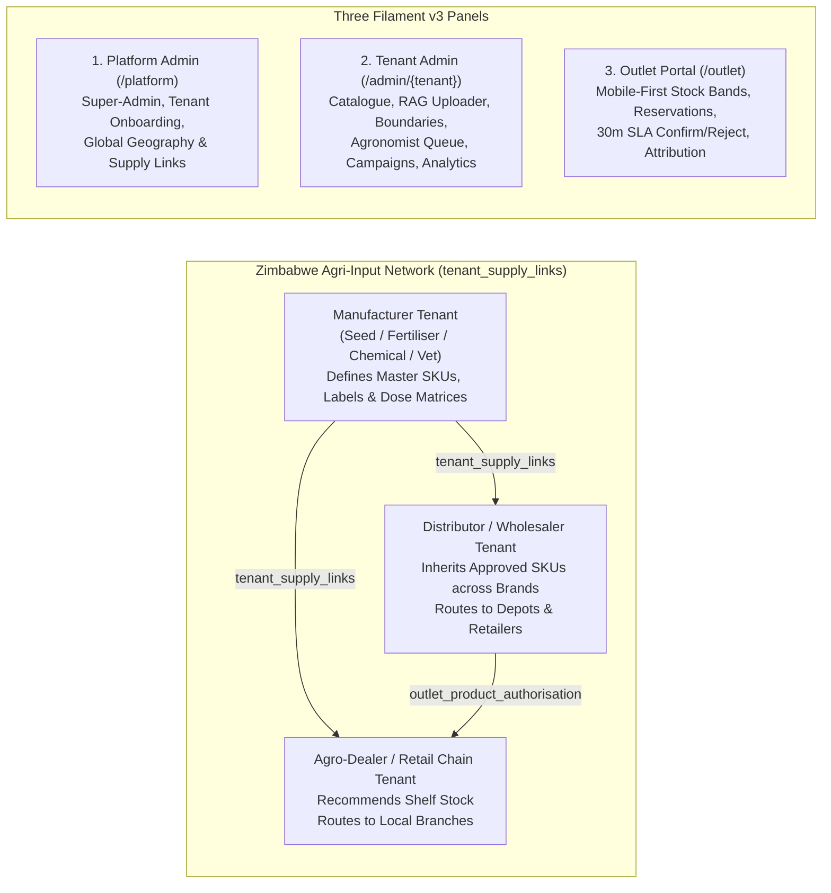
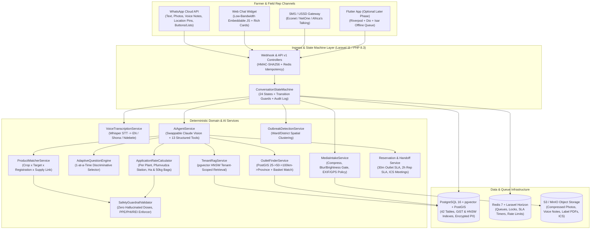

# BetterlinkAgr AI — System Architecture Document

## 1. Product Vision & Core Loop

**BetterlinkAgr AI** is a white-label, multi-tenant **AI Agri-Input Sales Representative** purpose-built for the **Zimbabwean agricultural market**.

Agri-input companies—**Manufacturers** (fertiliser, agrochemical, seed, animal health), **Distributors/Wholesalers**, and **Agro-Dealer/Retail Chains**—deploy the agent under their own brand across **WhatsApp Cloud API**, a **Web Chat Widget**, and **SMS/USSD fallback** (plus an optional offline-first **Flutter rep & farmer app**).

Core loop:
**Profile -> Engage -> Diagnose -> Recommend -> Qualify -> Connect** (plus post-treatment follow-up and ward-level outbreak learning).

**Guiding Principle**:
> **The LLM words things and calls tools; deterministic PHP/SQL/PostGIS services decide doses, application rates, stock availability, spatial distances, and routing.**

---

## 2. Platform & Supply Network Architecture

### Recommendation Scope & Agronomic Integrity
- Each tenant configures `recommendation_scope`:
  - `own_brands_only`: Only recommends SKUs owned by the tenant.
  - `own_plus_partner_brands`: Recommends own SKUs plus SKUs inherited via active `tenant_supply_links`.
- **Competitor Exclusion**: Competitor products are never recommended unless the tenant explicitly stocks and authorises them.
- **Agronomic Fit First**: When multiple stocked products match a `(crop, target)` pair, `ProductMatcherService` ranks candidates strictly by **agronomic fit and resistance-management rotation** (`agronomic_fit_rank_score`), **never by commercial margin**.

---

## 3. High-Level System Architecture

---

## 4. AiAgentService & The 13 Deterministic Tools

`AiAgentService` wraps Anthropic Claude (via `AiProviderContract` so providers can be swapped cleanly) and exposes **13 structured tools** whose implementations are 100% deterministic PHP services:

| # | Tool Name | Deterministic Backing Service | Purpose |
| :--- | :--- | :--- | :--- |
| 1 | `identify_from_image` | `VisionDiagnosisService` | First-pass multimodal identification returning top 3 candidates, `sn`/`nd` names, confidence, visible evidence, look-alikes, and missing info. |
| 2 | `search_knowledge` | `TenantRagService` | Hybrid `pgvector` cosine similarity search over tenant-approved labels, pest guides, and agronomy manuals (`WHERE tenant_id = ?`). |
| 3 | `lookup_products` | `ProductMatcherService` | Queries approved & Zimbabwe-registered products for `(crop, target)` across own & linked partner catalogues, ranked by agronomic fit. |
| 4 | `calculate_application_rate` | `ApplicationRateCalculator` | Computes exact chemical doses (`ml`/`g` per 16 L knapsack & per ha) and fertiliser rates (**per plant**, **per Pfumvudza station**, **per ha + 50 kg bags**) with working shown. |
| 5 | `get_weather` | `ZimbabweWeatherService` | Fetches ward forecast and evaluates safe spraying windows (wind `3–15 km/h`, rain prob `<30%`, temp `<30°C`). |
| 6 | `update_farmer_profile` | `FarmerProfilingService` | Saves progressive profile fields (name, ward, farm size, crops, livestock, sector, Pfumvudza) and emits a `profile_updated` card + updated `context_chip`. |
| 7 | `request_farmer_location` | `LocationResolutionService` | Requests WhatsApp location pin / web GPS with explicit `location_consents` or resolves ward/growth-point fallback via `ward_centroids`. |
| 8 | `find_nearest_outlets` | `OutletFinderService` | Runs PostGIS spatial query (`25 -> 50 -> 100 km -> province`) for authorised outlets with live stock, ranking by stock confidence/freshness, distance, open now, delivery, and price. |
| 9 | `check_outlet_stock` | `OutletStockService` | Verifies SKU pack availability, currency-specific price (`USD`/`ZiG`), and 48-hour stock freshness timestamp at a specific outlet. |
| 10 | `create_reservation` | `ReservationService` | Creates a stock hold ("Hold this for me") + `Lead`, notifies the outlet manager via WhatsApp/push, and starts the 30-minute outlet SLA timer. |
| 11 | `create_lead` | `LeadQualificationService` | Records a scored opportunity (`cold`/`warm`/`hot` with reasons, crop, ha, purchase window, basket value) and routes to rep/dealer. |
| 12 | `handoff_to_human` | `HandoffRoutingService` | Escalates to an agronomist/vet (low confidence, high stakes, no registered SKU) or sales rep (pricing, credit, contracts) and switches mode to `human_takeover` when claimed. |
| 13 | `schedule_meeting` | `MeetingSchedulerService` | Proposes 2–3 rep availability slots, confirms a phone/WhatsApp call or farm visit, generates an `.ics` calendar file, and schedules reminders. |

---

## 5. Location-Aware Retailer Finder (`OutletFinderService`)

1. **Location Resolution Priority & Privacy Guardrail**:
   - **Priority 1**: WhatsApp location pin / live location or Web/App GPS (stored in `farmer_locations` with `location_consents`).
   - **Priority 2**: Saved farm coordinates (`farms` / `farmer_locations`).
   - **Priority 3**: Ward or growth-point centroid from `ward_centroids` (`is_approximate = true`).
   - **Privacy Invariant**: Exact farmer GPS coordinates are **never** exposed to outlets during browsing or stock checks; outlets see only the **ward name and distance band** (e.g., `"Mazowe Ward 14 (~12 km away)"`) until the farmer explicitly confirms a reservation or callback.
2. **Deterministic PostGIS Ranking**:
   - Filters `outlets` joined with `outlet_product_authorisation` and `outlet_stock` where `is_active = true` and `quantity_band != 'out_of_stock'`.
   - Expands search radius automatically: **25 km -> 50 km -> 100 km -> same Province**.
   - Scores outlets using tenant-configurable weights:
     $$\text{Score} = w_{\text{stock}} S_{\text{fresh}} + w_{\text{dist}} S_{\text{dist}} + w_{\text{open}} S_{\text{open}} + w_{\text{deliv}} S_{\text{deliv}} + w_{\text{price}} S_{\text{price}}$$
   - **Whole-Basket Preference**: Prioritises outlets that carry **all** recommended items in the diagnosis basket.
   - **Stale Stock Guardrail**: If `outlet_stock.last_updated_at < now() - 48 hours` (tenant configurable), the card explicitly flags `"Stock updated >48h ago — please call or Hold to confirm"`. Never invents stock.
3. **Reservation & Attribution Loop**:
   - Clicking **"Hold this for me"** transitions the conversation to `RESERVATION_PENDING`, notifies the outlet manager on WhatsApp/Outlet Portal, and starts a **30-minute SLA timer**.
   - If rejected or SLA expires, `ReservationSlaCheckJob` automatically offers the **next nearest outlet**, and if all outlets fail, escalates to a human sales rep (`LEAD_ROUTED_TO_REP`).
   - When marked **"Bought / Sold"**, `SalesAttribution` records the exact conversion path (`conversation_id -> diagnosis_id -> outlet_id -> product_id -> amount & currency`).

---

## 6. Rich Message Cards & Connected Farmer Profile Panel

- **7 Structured Rich Card Types**:
  1. `diagnosis_result`: Candidate summary, confidence badge, local Shona/Ndebele name, severity, and visual evidence.
  2. `recommended_product`: Product name, active ingredient, IRAC/FRAC group, pack sizes, dual price (`USD`/`ZiG`), PHI, REI, PPE, and label citation.
  3. `application_guidance`: Tick-list (`✓`) of mixing order, knapsack/hectare/Pfumvudza rates, weather window, and Today / This Week / +7d steps.
  4. `profile_updated`: Confirmation card after progressive profiling showing updated farmer/farm attributes.
  5. `event_invite`: Field day, demo, or webinar card with date, venue/link, and interactive RSVP buttons (`Going`, `Maybe`, `Can't make it`).
  6. `outlet_list`: Top 3 nearest stocked outlets with distance, travel time, open/closed badge, stock freshness badge, price, WhatsApp/call links, and `"Hold this for me"` buttons.
  7. `handoff_summary`: Context card delivered to the sales rep, outlet manager, or agronomist upon escalation.
- **Conversation Context Chip**: Every conversation header displays a live context chip (`"Crop / growth stage / conditions"`, e.g., `"Maize / V6 vegetative / humid"` or `"Tomato / fruiting / dry spell"`).
- **Connected Farmer Profile Panel**: Displayed alongside every live chat in Filament and the Rep App, showing Farmer ID, crop & variety, ward & Natural Region, last active timestamp, growth stage, hectarage, recent diagnosis challenge, and **"Approved portfolio for this context"** with a **"Show all approved options"** drawer.

---

## 7. Security, Multi-Tenancy & Zimbabwe CDPA Compliance

1. **Global Farmer Identity + Per-Tenant Isolation**:
   - `farmers` is keyed globally by `phone_hash` (`HMAC-SHA256`) with AES-256 encrypted PII (`phone_encrypted`, `full_name_encrypted`, `national_id_encrypted`) so a farmer is recognised seamlessly, while `consents`, `location_consents`, `conversations`, `diagnoses`, `leads`, `reservations`, and `audit_logs` are strictly isolated per `tenant_id` via `TenantScope`.
   - **Outlet Portal Isolation**: Users with the `outlet_manager` role are scoped via `OutletScope` to view and manage only their assigned `outlet_id` stock, reservations, and leads.
2. **Cyber and Data Protection Act [Cap 12:07]**:
   - Mandatory opt-in gate (`CONSENT_CHECK -> AWAITING_CONSENT`) before processing personal or farm data.
   - Instant trilingual opt-out (`STOP`, `MIRA`, `MANA`) and opt-in (`START`, `TANGA`, `QALA`).
   - Full JSON data export and right-to-erasure anonymization endpoints.
3. **Immutable Audit Trail (`audit_logs`)**:
   - Every state machine transition and every AI response logs the input image SHA-256 hash, vision candidates JSON, clarifying questions asked, deterministic tool payloads, RAG chunk IDs, guardrail verification result, and model token/latency telemetry.
