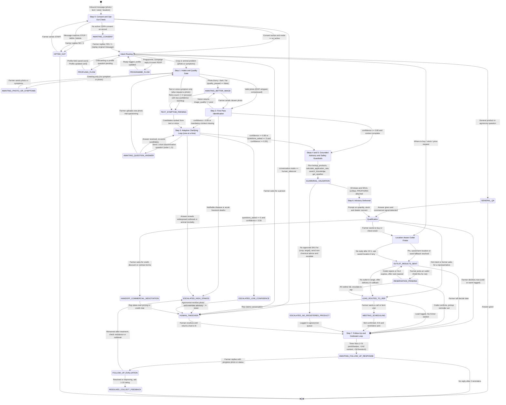
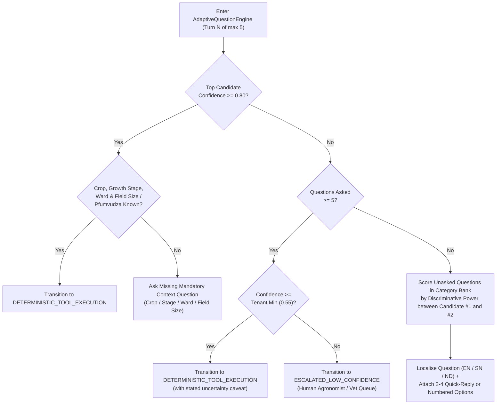

# BetterlinkAgr AI — Conversation & Diagnosis State Machine (Authoritative Spec)

Every inbound message from any channel (WhatsApp Cloud API, Web Chat Widget, SMS/USSD, or Flutter App) enters through `ConversationStateMachine` at `CONSENT_CHECK`. Every state transition is validated by a transition guard, persisted to `conversations.state`, and written as an immutable record to `audit_logs`.

---

## 1. Authoritative State Machine Diagram

---

## 2. State Rules and Invariants

| State | Entry Actions | Exit / Guard |
| :--- | :--- | :--- |
| `CONSENT_CHECK` | Check opt-out keywords (`STOP`, `MIRA`, `MANA`) first, then active `Consent` row for `(tenant_id, farmer_id)`, then `conversation.mode`. | Exactly one of `OPTED_OUT`, `AWAITING_CONSENT`, `HUMAN_TAKEOVER`, `INTENT_ROUTING`. |
| `OPTED_OUT` | Mark `consents.revoked_at`, suppress all outbound campaigns/follow-ups, send opt-out confirmation (`Reply START to re-enable`). | Only transitions back to `CONSENT_CHECK` if farmer sends `START` / `TANGA` / `QALA`. |
| `AWAITING_CONSENT` | Send a short consent prompt in the farmer's language (`1` Yes, `2` No) explaining what data is kept and why under the Cyber and Data Protection Act [Cap 12:07]. | `1`/Yes writes a `Consent` row and replays the original buffered message into `INTENT_ROUTING`. `2`/No transitions to `OPTED_OUT`. |
| `INTENT_ROUTING` | Classify intent (`problem_diagnosis`, `profiling`, `programme_or_event`, `buy_where_stock`, `general_qa`, `human_request`). | Problem diagnosis and buy/stock intents always take priority over pending progressive profiling questions. |
| `PROFILING_FLOW` | Save progressive profile answer via `update_farmer_profile`, update conversation `context_chip`, and emit a `profile_updated` card listing saved fields. | Returns to `INTENT_ROUTING`. |
| `PROGRAMME_FLOW` | Record programme milestone reply, campaign response, or `event_rsvps` confirmation. | Returns to `INTENT_ROUTING`. |
| `GENERAL_QA` | Retrieve tenant-scoped RAG chunks (`search_knowledge`) and answer general product or agronomy question. | If commercial buying signal is detected, transition to `QUALIFYING_BUYING_INTENT`; otherwise complete turn. |
| `INTAKE_PROCESSING` | Voice: transcribe via `VoiceTranscriptionService`. Image: strip EXIF (keep GPS only with active `location_consents`), compress, compute blur/brightness/resolution. | Failed quality gate -> `AWAITING_BETTER_IMAGE`. Valid photo -> `VISION_IDENTIFICATION`. Text/voice symptom only -> `TEXT_SYMPTOM_PARSING` (and ask for photo). |
| `AWAITING_BETTER_IMAGE` | Send framing guidance (leaf top and underside, insect on plant, whole plant, affected field area) in `en`/`sn`/`nd`. | After 2 poor photos (`poor_photo_retries >= 2`), fall back to `TEXT_SYMPTOM_PARSING` with an explicit low-confidence caveat. |
| `VISION_IDENTIFICATION` | `AiAgentService::identifyFromImage()`. Persist a `Diagnosis` with `category`, `crop`, `growth_stage`, top 3 `candidates_json` (with `sn`/`nd` names), `image_quality`, `missing_information_json`. | Never present one answer as certain if `confidence < 0.80`. Route to `ESCALATED_HIGH_STAKES`, `CLARIFYING_QUESTIONS`, or `DETERMINISTIC_TOOL_EXECUTION`. |
| `CLARIFYING_QUESTIONS` | `AdaptiveQuestionEngine::selectNextQuestion()`. Persist each `DiagnosisQuestion` (`order = 1..5`). | Loop while `confidence < 0.80` and `questions_asked < 5`. |
| `DETERMINISTIC_TOOL_EXECUTION` | Run `lookup_products`, `calculate_application_rate`, `search_knowledge`, `get_weather`. | Pass structured tool results to `GUARDRAIL_VALIDATION`. |
| `GUARDRAIL_VALIDATION` | Verify every SKU, dose per 16 L knapsack, dose per ha, PHI, REI and fertiliser rate against DB rows. Attach PPE and safety text. Write `AuditLog`. | No registered product for `(crop, target)` goes to `ESCALATED_NO_REGISTERED_PRODUCT`. Verified advisory goes to `ADVISORY_DELIVERED`. |
| `ADVISORY_DELIVERED` | Send formatted WhatsApp/Web rich cards (`diagnosis_result`, `recommended_product`, `application_guidance`). | Immediately transition to `QUALIFYING_BUYING_INTENT` and prompt on quantity, stock check, and dealer connection. |
| `QUALIFYING_BUYING_INTENT` | Score lead (`cold`/`warm`/`hot`) with stored reasons. | `wants_to_buy_or_check_stock` -> `AWAITING_LOCATION`; `hot_intent_or_rep_requested` -> `LEAD_ROUTED_TO_REP`; `credit_or_discount_requested` -> `HANDOFF_COMMERCIAL_NEGOTIATION`; `declines_now` -> `FOLLOW_UP_SCHEDULED`. |
| `AWAITING_LOCATION` | Ask for a WhatsApp location pin or use the saved farm location (`farmer_locations`), with explicit `location_consents`. Fallback: ask for ward or business centre. | Resolve to coordinates (accuracy & source stored) or a `ward_centroids` point marked approximate -> `OUTLET_RESULTS_SENT` (or after 24h timeout using saved location). |
| `OUTLET_RESULTS_SENT` | Execute `OutletFinderService` (PostGIS radius `25 -> 50 -> 100 km -> province`, ranked by stock confidence/freshness, distance, open now, delivery, price). Send `outlet_list` card (top 3). | Farmer clicks "Hold this for me" -> `RESERVATION_PENDING`. No outlet in range -> `LEAD_ROUTED_TO_REP`. Will decide later -> `FOLLOW_UP_SCHEDULED`. |
| `RESERVATION_PENDING` | Create `Reservation` + `Lead` with quantity from `calculate_application_rate`. Notify outlet manager via WhatsApp/push. Start 30-min outlet SLA timer. | Outlet confirms -> `FOLLOW_UP_SCHEDULED` (with pickup reminder). Outlet rejects or SLA expires -> offer next nearest (`OUTLET_RESULTS_SENT`), or if all fail -> `LEAD_ROUTED_TO_REP`. |
| `LEAD_ROUTED_TO_REP` | Auto-assign to nearest rep/dealer by ward/district with full context summary (`handoff_summary`). Start 2h rep SLA timer. | Farmer wants call/visit -> `MEETING_SCHEDULING`. Rep claims live chat -> `HUMAN_TAKEOVER`. Otherwise -> `FOLLOW_UP_SCHEDULED`. |
| `MEETING_SCHEDULING` | Propose 2–3 rep availability slots via `schedule_meeting`. On confirmation, create `Meeting`, generate `.ics` file, schedule WhatsApp reminders. | Transitions to `FOLLOW_UP_SCHEDULED`. |
| `HUMAN_TAKEOVER` | Set `conversation.mode = human_takeover`. Suppress AI replies. Forward farmer messages to Filament live chat and rep's WhatsApp. | "Return to AI" or resolve goes to `FOLLOW_UP_SCHEDULED`. |
| `FOLLOW_UP_SCHEDULED` | Dispatch `SendFollowUpCheckInJob` (`+7d` pest/disease, `+14d` nutrient, `+3d` livestock). Run `OutbreakDetectionService` for the ward. | A new unrelated photo before the timer starts a new `Diagnosis`. Timer firing transitions to `AWAITING_FOLLOW_UP_RESPONSE`. |

---

## 3. `ConversationStateMachine` Implementation Plan (Phase 3 Core)

1. **State Enum (`App\Enums\ConversationState`)**:
   - Strictly typed PHP 8.3 backed string enum representing all 24 states in the authoritative diagram above.
2. **Transition Map & Guards (`App\Services\Diagnosis\ConversationStateMachine`)**:
   - `canTransition(Conversation $conversation, ConversationState $to, array $context = []): bool` validates that `$from -> $to` is an allowed edge in the transition matrix and that guard predicates (e.g., `hasActiveConsent()`, `isConfidenceAboveThreshold()`, `hasVerifiedGuardrails()`) hold.
   - `transitionTo(Conversation $conversation, ConversationState $to, string $reason, array $metadata = []): void`:
     - Wraps state update in a DB transaction with row-level lock (`SELECT ... FOR UPDATE` or Redis lock `conv_lock:{id}`).
     - Updates `conversations.state = $to` and `conversations.state_updated_at = now()`.
     - Writes an immutable entry to `audit_logs` (`event_type = 'state_transition'`, `from_state`, `to_state`, `reason`, `metadata`).
     - Executes the target state's entry action handler.
3. **Per-Tenant Configurable Thresholds (`tenants.boundaries_config`)**:
   - `high_confidence_threshold`: default `0.80`
   - `min_confidence_threshold`: default `0.55`
   - `max_clarifying_questions`: default `5`
   - `followup_days_pest_disease`: default `7`
   - `followup_days_nutrient`: default `14`
   - `followup_days_livestock`: default `3`
   - `stock_freshness_limit_hours`: default `48`
   - `outlet_sla_minutes`: default `30`
   - `rep_sla_minutes`: default `120`

---

## 4. Adaptive Question Selection Flow (`AdaptiveQuestionEngine`)

