# BetterlinkAgr AI — Entity-Relationship Diagram (ERD) & Schema Specification

## 1. Visual Entity-Relationship Diagram (Mermaid)

```mermaid
erDiagram
    TENANTS ||--o{ TENANT_SUPPLY_LINKS : "supplies_or_inherits"
    TENANTS ||--o{ USERS : "employs"
    TENANTS ||--o{ OUTLETS : "operates_or_authorises"
    TENANTS ||--o{ PRODUCTS : "catalogues"
    TENANTS ||--o{ PRODUCT_DOCUMENTS : "uploads"
    TENANTS ||--o{ KNOWLEDGE_CHUNKS : "indexes"
    TENANTS ||--o{ CONVERSATIONS : "owns"
    TENANTS ||--o{ CONSENTS : "records"
    TENANTS ||--o{ LOCATION_CONSENTS : "records"
    TENANTS ||--o{ PROGRAMMES : "defines"
    TENANTS ||--o{ CAMPAIGNS : "runs"
    TENANTS ||--o{ EVENTS : "hosts"
    TENANTS ||--o{ LEADS : "generates"
    TENANTS ||--o{ AUDIT_LOGS : "logs"

    PROVINCES ||--o{ DISTRICTS : "contains"
    DISTRICTS ||--o{ WARDS : "contains"
    WARDS ||--|| WARD_CENTROIDS : "has_centroid"
    WARDS ||--o{ FARMS : "locates"
    WARDS ||--o{ OUTLETS : "locates"
    WARDS ||--o{ WEATHER_SNAPSHOTS : "forecasts"
    WARDS ||--o{ OUTBREAK_SIGNALS : "clusters"

    FARMERS ||--o{ CONSENTS : "grants_per_tenant"
    FARMERS ||--o{ LOCATION_CONSENTS : "grants_gps"
    FARMERS ||--o{ FARMER_LOCATIONS : "pins"
    FARMERS ||--o{ FARMS : "operates"
    FARMERS ||--o{ CONVERSATIONS : "participates"
    FARMERS ||--o{ PROGRAMME_ENROLMENTS : "enrols"
    FARMERS ||--o{ EVENT_RSVPS : "rsvps"
    FARMERS ||--o{ RESERVATIONS : "requests"
    FARMERS ||--o{ LEADS : "qualifies_for"

    CONVERSATIONS ||--o{ MESSAGES : "contains"
    MESSAGES ||--o{ ATTACHMENTS : "includes"
    CONVERSATIONS ||--o{ DIAGNOSES : "triggers"
    CONVERSATIONS ||--o{ HANDOFFS : "escalates"
    CONVERSATIONS ||--o{ SALES_ATTRIBUTION : "originates"

    DIAGNOSES ||--o{ DIAGNOSIS_QUESTIONS : "asks"
    DIAGNOSES ||--o| ADVISORIES : "produces"
    DIAGNOSES ||--o{ FOLLOW_UPS : "schedules"
    USERS ||--o{ DIAGNOSES : "reviews (reviewed_by)"

    PRODUCTS ||--o{ PRODUCT_DOCUMENTS : "documented_by"
    PRODUCTS ||--o{ PRODUCT_TARGETS : "approved_for"
    PRODUCTS ||--o{ OUTLET_STOCK : "stocked_in"
    PRODUCTS ||--o{ OUTLET_PRODUCT_AUTHORISATION : "authorised_for"
    CROPS ||--o{ PRODUCT_TARGETS : "targeted_on"
    CROPS ||--o{ FERTILISER_RECOMMENDATIONS : "nourished_by"

    OUTLETS ||--o{ OUTLET_USERS : "staffed_by"
    OUTLETS ||--o{ OUTLET_STOCK : "holds"
    OUTLETS ||--o{ OUTLET_PRODUCT_AUTHORISATION : "carries"
    OUTLETS ||--o{ RESERVATIONS : "fulfils"
    OUTLETS ||--o{ SALES_ATTRIBUTION : "credits"

    LEADS ||--o{ LEAD_ACTIVITIES : "tracks"
    LEADS ||--o| HANDOFFS : "routed_via"
    LEADS ||--o{ MEETINGS : "books"
    LEADS ||--o{ RESERVATIONS : "links"
    LEADS ||--o{ SALES_ATTRIBUTION : "converts_to"

    TENANTS {
        uuid id PK
        string name
        string slug UK
        string tenant_type "manufacturer|distributor|agro_dealer"
        string recommendation_scope "own_brands_only|own_plus_partner_brands"
        string whatsapp_phone_number_id UK
        decimal usd_to_zig_rate
        jsonb persona_config "name, tone, languages, branding"
        jsonb boundaries_config "allowed_categories, high_conf:0.80, min_conf:0.55, restricted_skus, disclaimers"
        jsonb outlet_ranking_weights "stock_conf, distance, open_now, delivery, price"
        jsonb crm_config "mode: standalone|integrated, adapter: csv|webhook|hubspot|zoho"
        boolean is_active
        timestamp deleted_at
    }

    TENANT_SUPPLY_LINKS {
        uuid id PK
        uuid manufacturer_tenant_id FK
        uuid distributor_or_retailer_tenant_id FK
        jsonb approved_product_ids_json "Inherited SKU UUIDs"
        string status "pending|active|suspended|revoked"
        timestamp deleted_at
    }

    FARMERS {
        uuid id PK
        string phone_hash UK "Global HMAC-SHA256 of +263 E.164 phone"
        text phone_encrypted "Encrypted E.164 (+263...)"
        text full_name_encrypted "Encrypted PII"
        text national_id_encrypted "Nullable Encrypted PII"
        string preferred_language "en|sn|nd"
        string farming_sector "communal|a1|a2|small_scale_commercial|large_scale_commercial"
        boolean is_pfumvudza_enrolled
        boolean is_contract_farmer
        jsonb suppliers_used_json
        string preferred_contact_time "morning|afternoon|evening|any"
        timestamp last_active_at
        timestamp deleted_at
    }

    FARMER_LOCATIONS {
        uuid id PK
        uuid farmer_id FK
        uuid tenant_id FK "nullable"
        uuid ward_id FK "nullable"
        geography location_point "PostGIS GEOGRAPHY(Point, 4326)"
        decimal accuracy_meters "nullable"
        string source "whatsapp_pin|live_location|app_gps|saved_farm|ward_centroid"
        boolean is_approximate
        timestamp captured_at
    }

    CONVERSATIONS {
        uuid id PK
        uuid tenant_id FK
        uuid farmer_id FK
        string channel "whatsapp|web_chat|sms|ussd|flutter_app"
        string state "CONSENT_CHECK..RESOLVED_COLLECT_FEEDBACK"
        string mode "ai_active|human_takeover"
        string language "en|sn|nd"
        string context_chip "e.g. Maize / V6 vegetative / humid"
        uuid assigned_user_id FK "nullable"
        jsonb pending_message_buffer_json
        timestamp last_message_at
        timestamp deleted_at
    }

    OUTLETS {
        uuid id PK
        uuid tenant_id FK
        string outlet_type "retail_branch|authorized_stockist|distributor_depot|agro_dealer"
        string name
        string address
        uuid province_id FK
        uuid district_id FK
        uuid ward_id FK
        geography location_point "PostGIS GEOGRAPHY(Point, 4326) GiST indexed"
        jsonb operating_hours_json
        string phone
        string whatsapp_number
        decimal delivery_radius_km
        decimal delivery_fee_amount
        string delivery_fee_currency "USD|ZIG"
        jsonb accepted_payments_json "['USD_CASH','ZIG_CASH','ECOCASH','PAYNOW','SWIPE']"
        boolean is_active
        timestamp deleted_at
    }

    OUTLET_STOCK {
        uuid id PK
        uuid tenant_id FK
        uuid outlet_id FK
        uuid product_id FK
        string pack_size "e.g. 1L, 50kg"
        string quantity_band "in_stock|low_stock|out_of_stock"
        integer exact_quantity "nullable"
        decimal price
        string currency "USD|ZIG"
        string source "outlet_portal|whatsapp_bot|csv_upload|erp_webhook"
        timestamp last_updated_at
    }

    RESERVATIONS {
        uuid id PK
        uuid tenant_id FK
        uuid outlet_id FK
        uuid farmer_id FK
        uuid conversation_id FK
        uuid diagnosis_id FK "nullable"
        uuid lead_id FK
        jsonb basket_items_json "[{'product_id':'...','pack_size':'50kg','qty':5,'price':32.00,'currency':'USD'}]"
        string status "pending|confirmed|rejected|alternative_proposed|expired|picked_up|cancelled"
        text rejection_or_alternative_note "nullable"
        timestamp sla_due_at "Default +30 min"
        timestamp confirmed_at "nullable"
        timestamp pickup_reminder_at "nullable"
        timestamp fulfilled_at "nullable"
        timestamp deleted_at
    }

    SALES_ATTRIBUTION {
        uuid id PK
        uuid tenant_id FK
        uuid conversation_id FK
        uuid diagnosis_id FK "nullable"
        uuid lead_id FK
        uuid reservation_id FK "nullable"
        uuid outlet_id FK "nullable"
        uuid product_id FK
        uuid farmer_id FK
        decimal quantity_sold
        decimal total_amount
        string currency "USD|ZIG"
        boolean is_first_ai_engaged_sale
        boolean is_upsell_on_engaged_farmer
        timestamp attributed_at
    }
```

---

## 2. Complete Table-by-Table Specification (42 Tables)

All primary keys use **UUID v7** (`uuid`). Spatial columns use **PostGIS `GEOGRAPHY(Point, 4326)`** with **GiST** indexes (`CREATE INDEX ... USING GIST (location_point)`). Vector columns use **pgvector `vector(1024)`** with **HNSW** indexes (`CREATE INDEX ... USING hnsw (embedding vector_cosine_ops)`).

### 2.1 Multi-Tenant Network & Supply Chain
1. **`tenants`**: Represents a Manufacturer, Distributor/Wholesaler, or Agro-Dealer Chain.
   - `tenant_type`: `manufacturer | distributor | agro_dealer`
   - `recommendation_scope`: `own_brands_only | own_plus_partner_brands`
   - `persona_config`: JSONB (brand name, greeting, tone, enabled languages `['en','sn','nd']`).
   - `boundaries_config`: JSONB (`allowed_categories`, `high_confidence_threshold` [0.80], `min_confidence_threshold` [0.55], `max_clarifying_questions` [5], `stock_freshness_hours` [48], `outlet_sla_minutes` [30], `rep_sla_minutes` [120], `restricted_product_ids`, `mandatory_disclaimers`).
   - `outlet_ranking_weights`: JSONB (`stock_confidence`, `distance`, `open_now`, `delivery`, `price`).
   - `crm_config`: JSONB (`mode: standalone|integrated`, `adapter: csv|webhook|hubspot|zoho`, encrypted credentials).
2. **`tenant_supply_links`**: Models the `Manufacturer -> Distributor -> Retailer/Outlet` network (`manufacturer_tenant_id`, `distributor_or_retailer_tenant_id`, `approved_product_ids_json`, `status` [`pending`, `active`, `suspended`, `revoked`]). Allows a distributor or agro-dealer to inherit approved product definitions, labels, and dose matrices from a manufacturer.
3. **`users`**: Platform & tenant staff (`tenant_id` nullable for `super_admin`, `role` [`super_admin`, `tenant_admin`, `agronomist`, `sales_rep`, `outlet_manager`], `name`, `email`, `phone_encrypted`, `languages_json`, `availability_schedule_json`, `is_available_for_handoff`).

### 2.2 Zimbabwe Geography & Spatial Reference (PostGIS)
4. **`provinces`**: 10 Zimbabwean provinces (`code`, `name`).
5. **`districts`**: 60+ Zimbabwean districts (`province_id`, `code`, `name`).
6. **`wards`**: Administrative wards (`district_id`, `ward_number`, `name`, `natural_region` [`I`, `IIa`, `IIb`, `III`, `IV`, `V`]).
7. **`ward_centroids`**: Seeded centroid coordinate for every ward (`ward_id` PK/FK, `growth_point_name`, `centroid GEOGRAPHY(Point, 4326)` GiST indexed, `latitude`, `longitude`). Used as the approximate fallback when a farmer shares only their ward or growth point.

### 2.3 Global Farmer Identity, Per-Tenant Consent & Farm Context
8. **`farmers`**: **Global farmer identity** across the platform, keyed by `phone_hash` (HMAC-SHA256 of normalized `+263...` phone) with AES-256 encrypted PII (`phone_encrypted`, `full_name_encrypted`, `national_id_encrypted`), `preferred_language` (`en`, `sn`, `nd`), `farming_sector` (`communal`, `a1`, `a2`, `small_scale_commercial`, `large_scale_commercial`), `is_pfumvudza_enrolled`, `is_contract_farmer`, `suppliers_used_json`, `preferred_contact_time`.
9. **`consents`**: **Per-tenant** Cyber and Data Protection Act [Cap 12:07] & WhatsApp opt-in state (`tenant_id`, `farmer_id`, `status` [`pending`, `opted_in`, `opted_out`], `data_processing_consent`, `marketing_consent`, `opt_out_keyword_used` [`STOP`, `MIRA`, `MANA`], `consented_at`, `revoked_at`). Unique index on `(tenant_id, farmer_id)`.
10. **`location_consents`**: **Per-tenant** explicit GPS location-sharing consent (`tenant_id`, `farmer_id`, `share_exact_with_outlet_consent`, `consented_at`, `revoked_at`). Enforces the rule: *Never share exact coordinates with outlets; share ward and distance band until the farmer agrees to be contacted.*
11. **`farmer_locations`**: Stored spatial coordinates (`farmer_id`, `tenant_id`, `ward_id`, `location_point GEOGRAPHY(Point, 4326)` GiST indexed, `latitude_encrypted`, `longitude_encrypted`, `accuracy_meters`, `source` [`whatsapp_pin`, `live_location`, `app_gps`, `saved_farm`, `ward_centroid`], `is_approximate`, `captured_at`).
12. **`farms`**: Farmer plots (`farmer_id`, `tenant_id` nullable, `ward_id`, `name`, `natural_region`, `total_area_ha`, `cultivated_area_ha`, `soil_type`, `soil_ph`, `is_pfumvudza_plot`, `pfumvudza_plots_count`, `crops_grown_json`, `livestock_kept_json`).
13. **`crops`**: Botanical & Zimbabwean agronomic reference (`code`, `name_en`, `name_sn`, `name_nd`, `season_type` [`summer`, `winter`, `perennial`, `all_year`], `default_row_spacing_cm`, `default_inrow_spacing_cm`, `pfumvudza_supported`).
14. **`livestock`**: Livestock reference (`code`, `name_en`, `name_sn`, `name_nd`, `category` [`cattle`, `goats`, `poultry`]).

### 2.4 Conversations, Rich Message Cards & Diagnosis Engine
15. **`conversations`**: Per-tenant stateful thread (`tenant_id`, `farmer_id`, `channel`, `external_thread_id`, `state` [24-state machine enum], `mode` [`ai_active`, `human_takeover`], `language` [`en`, `sn`, `nd`], `context_chip` [e.g. `"Pepper / fruiting / humid"`], `poor_photo_retries`, `pending_message_buffer_json`, `assigned_user_id`, `last_message_at`).
16. **`messages`**: Individual messages (`tenant_id`, `conversation_id`, `direction`, `sender_type`, `external_message_id` UK for idempotency, `message_type` [`text`, `image`, `audio`, `location`, `interactive`, `rich_card`], `card_type` nullable [`diagnosis_result`, `recommended_product`, `application_guidance`, `profile_updated`, `event_invite`, `outlet_list`, `handoff_summary`], `card_payload_json`, `body_text`, `transcribed_text`, `detected_language`).
17. **`attachments`**: Media files (`tenant_id`, `message_id`, `disk`, `file_path`, `mime_type`, `file_size_bytes`, `sha256_hash`, `width`, `height`, `blur_score`, `brightness_score`, `quality_passed`, `exif_stripped`).
18. **`diagnoses`**: Diagnostic session (`tenant_id`, `conversation_id`, `farmer_id`, `farm_id`, `primary_attachment_id`, `crop_id`, `livestock_id`, `category`, `growth_stage`, `image_quality`, `candidates_json` [top 3 with `sn`/`nd` local names, `visible_evidence`, `look_alikes`], `missing_information_json`, `final_diagnosis_name`, `final_diagnosis_code`, `confidence`, `questions_asked_count`, `status`, `escalation_reason`, `reviewed_by`, `agronomist_confirmed`, `agronomist_corrected_code`, `agronomist_notes`, `reviewed_at`).
19. **`diagnosis_questions`**: Clarifying questions asked one at a time (`tenant_id`, `diagnosis_id`, `question_order` 1..5, `question_key`, `question_text`, `options_json`, `farmer_answer`, `confidence_before`, `confidence_after`, `asked_at`, `answered_at`).
20. **`advisories`**: Grounded advisory output (`tenant_id`, `diagnosis_id`, `advisory_type`, `steps_json`, `products_json`, `rates_json`, `weather_window_json`, `safety_warnings_text`, `rendered_message_text`, `guardrail_passed`, `farmer_thumbs_up`, `farmer_rating` 1..10).

### 2.5 Product Catalogue, Agronomy Tables & Tenant RAG
21. **`products`**: Approved SKUs (`tenant_id`, `manufacturer_tenant_id` nullable, `sku`, `name`, `brand_name`, `category`, `active_ingredient`, `mode_of_action_group`, `registration_number`, `registration_expiry`, `hazard_colour_band`, `is_restricted_use`, `agronomic_fit_rank_score`, `differentiation_notes`, `pack_sizes_json`, `ppe_requirements_json`, `safety_warnings_json`, `is_active`).
22. **`product_documents`**: Uploaded label PDFs & guides (`tenant_id`, `product_id` nullable, `document_type`, `title`, `language`, `file_path`, `file_hash`, `ingestion_status`, `chunks_count`).
23. **`product_targets`**: Deterministic crop x target dose matrix (`tenant_id`, `product_id`, `crop_id`, `livestock_id`, `target_type`, `target_code`, `target_name_en`, `target_name_sn`, `target_name_nd`, `dose_per_16l_knapsack_value`, `dose_per_16l_knapsack_unit`, `dose_per_ha_value`, `dose_per_ha_unit`, `water_volume_per_ha_litres`, `mixing_order`, `application_timing_notes`, `reapplication_interval_days`, `phi_days`, `rei_hours`, `source_document_id`, `source_page_number`).
24. **`fertiliser_recommendations`**: Deterministic nutrition table (`tenant_id`, `crop_id`, `product_id`, `natural_region`, `soil_type`, `growth_stage`, `nutrient_addressed`, `fertiliser_type_name`, `rate_kg_per_ha`, `rate_grams_per_plant`, `rate_grams_per_pfumvudza_station`, `local_measure_equivalent`, `placement_method`, `timing_notes`, `precautions_notes`).
25. **`knowledge_chunks`**: Tenant-scoped pgvector embeddings (`tenant_id`, `product_document_id`, `document_type`, `crop_code`, `language`, `title`, `chunk_index`, `page_number`, `content`, `embedding vector(1024)` HNSW indexed, `metadata_json`, `is_active`).

### 2.6 Location-Aware Outlets, Stock, Reservations & Attribution
26. **`outlets`**: Branches, stockists, and depots (`tenant_id`, `outlet_type`, `name`, `address`, `province_id`, `district_id`, `ward_id`, `location_point GEOGRAPHY(Point, 4326)` GiST indexed, `latitude`, `longitude`, `operating_hours_json`, `phone`, `whatsapp_number`, `delivery_radius_km`, `delivery_fee_amount`, `delivery_fee_currency`, `accepted_payments_json`, `is_active`).
27. **`outlet_users`**: Pivot assigning `outlet_manager` users strictly to their own outlet(s) (`outlet_id`, `user_id`, `role`, `receives_whatsapp_alerts`).
28. **`outlet_stock`**: Real-time or band stock with explicit currency (`tenant_id`, `outlet_id`, `product_id`, `pack_size`, `quantity_band` [`in_stock`, `low_stock`, `out_of_stock`], `exact_quantity` nullable, `price`, `currency` [`USD`, `ZIG`], `last_updated_at`, `source` [`outlet_portal`, `whatsapp_bot`, `csv_upload`, `erp_webhook`]).
29. **`outlet_product_authorisation`**: Controls which SKUs an outlet is authorised to carry/recommend (`tenant_id`, `outlet_id`, `product_id`, `authorised_by_tenant_id`, `is_authorised`).
30. **`reservations`**: Stock holds ("Hold this for me") (`tenant_id`, `outlet_id`, `farmer_id`, `conversation_id`, `diagnosis_id`, `lead_id`, `basket_items_json`, `status` [`pending`, `confirmed`, `rejected`, `alternative_proposed`, `expired`, `picked_up`, `cancelled`], `rejection_reason`, `alternative_proposal_text`, `sla_due_at`, `confirmed_at`, `pickup_reminder_at`, `fulfilled_at`).
31. **`sales_attribution`**: Closed-loop revenue attribution (`tenant_id`, `conversation_id`, `diagnosis_id`, `lead_id`, `reservation_id`, `outlet_id`, `product_id`, `farmer_id`, `quantity_sold`, `total_amount`, `currency` [`USD`, `ZIG`], `is_first_ai_engaged_sale`, `is_upsell_on_engaged_farmer`, `attributed_at`).

### 2.7 Engagement: Programmes, Campaigns, Events & Outbreaks
32. **`programmes`**: Crop/livestock advisory programmes (`tenant_id`, `name`, `crop_id`, `target_stage`, `enrolment_rules_json`, `stage_messages_json`, `monthly_priority_question_json`, `is_active`).
33. **`programme_enrolments`**: Farmer membership in a programme (`tenant_id`, `programme_id`, `farmer_id`, `farm_id`, `current_stage`, `last_priority_response`, `enrolled_at`, `status`).
34. **`campaigns`**: Segmented WhatsApp/SMS broadcasts (`tenant_id`, `name`, `campaign_type`, `segment_filter_json`, `whatsapp_template_name`, `whatsapp_template_status` [`draft`, `submitted`, `approved`, `rejected`], `body_en`, `body_sn`, `body_nd`, `throttle_per_minute`, `scheduled_at`, `status`).
35. **`campaign_recipients`**: Per-farmer campaign delivery state (`tenant_id`, `campaign_id`, `farmer_id`, `status`, `sent_at`, `replied_at`).
36. **`events`**: Field days, demos, and webinars (`tenant_id`, `programme_id` nullable, `title`, `event_type` [`field_day`, `demo`, `webinar`], `crop_id`, `ward_id`, `location_point GEOGRAPHY(Point, 4326)` nullable, `venue_or_link`, `starts_at`, `ends_at`, `reminder_24h_sent`, `reminder_1h_sent`).
37. **`event_rsvps`**: Farmer event registrations and attendance (`tenant_id`, `event_id`, `farmer_id`, `rsvp_status` [`invited`, `going`, `maybe`, `declined`, `attended`], `responded_at`, `checked_in_at`).
38. **`outbreak_signals`**: Clustered ward/district pest & disease spikes (`tenant_id` nullable, `ward_id`, `district_id`, `crop_id`, `target_code`, `cases_count_7d`, `avg_confidence`, `severity` [`watch`, `warning`, `outbreak`], `alert_campaign_id`, `detected_at`).

### 2.8 Commercial Leads, Handoffs, Meetings, Follow-ups, Weather & Audit
39. **`leads`** & **`lead_activities`**:
    - `leads`: Opportunity record (`tenant_id`, `farmer_id`, `conversation_id`, `diagnosis_id`, `crop_id`, `area_ha`, `need_summary`, `purchase_window`, `temperature` [`cold`, `warm`, `hot`], `intent_score`, `score_reasons_json`, `requested_products_json`, `estimated_value`, `currency` [`USD`, `ZIG`], `needs_credit_or_contract`, `assigned_user_id`, `assigned_outlet_id`, `meeting_status`, `crm_status` [`draft`, `ready_for_crm`, `synced`, `failed`], `external_crm_id`, `status` [`new`, `accepted`, `contacted`, `quoted`, `won`, `lost`], `sla_due_at`, `first_response_at`, `closed_at`).
    - `lead_activities`: Timeline of rep/outlet actions (`tenant_id`, `lead_id`, `user_id`, `activity_type`, `notes`, `metadata_json`).
40. **`handoffs`** & **`meetings`**:
    - `handoffs`: Human escalation ticket (`tenant_id`, `conversation_id`, `diagnosis_id`, `lead_id`, `handoff_type` [`sales_rep`, `outlet_manager`, `agronomist`, `vet`], `assigned_user_id`, `outlet_id`, `priority`, `reason`, `context_summary_json`, `status` [`pending`, `accepted`, `rejected`, `reassigned`, `resolved`, `sla_breached`], `sla_due_at`, `accepted_at`, `resolved_at`).
    - `meetings`: Rep-farmer call or farm-visit bookings (`tenant_id`, `lead_id`, `conversation_id`, `farmer_id`, `rep_user_id`, `meeting_type` [`phone_call`, `whatsapp_call`, `farm_visit`], `proposed_slots_json`, `confirmed_starts_at`, `confirmed_ends_at`, `ics_file_path`, `status`, `visit_notes`, `visit_photos_json`).
41. **`follow_ups`** & **`weather_snapshots`**:
    - `follow_ups`: Scheduled `+7d`/`+14d`/`+3d` check-ins (`tenant_id`, `conversation_id`, `diagnosis_id`, `farmer_id`, `scheduled_for`, `reminders_sent_count`, `followup_attachment_id`, `outcome` [`pending`, `resolved`, `improving`, `worsened`, `no_reply`], `comparison_summary`).
    - `weather_snapshots`: Cached ward weather (`ward_id`, `fetched_at`, `valid_until`, `temp_celsius`, `humidity_pct`, `wind_speed_kmh`, `rain_probability_pct`, `is_safe_to_spray`, `spray_window_summary`, `forecast_json`).
42. **`audit_logs`**: Immutable ledger logging every state transition and every AI response (`tenant_id`, `conversation_id`, `diagnosis_id`, `user_id`, `event_type` [`state_transition`, `ai_diagnosis_turn`, `guardrail_check`, `location_lookup`, `reservation_event`, `human_takeover`], `from_state`, `to_state`, `attachment_sha256`, `candidates_json`, `questions_json`, `tool_calls_json`, `rag_chunk_ids_json`, `guardrail_result_json`, `created_at`).
